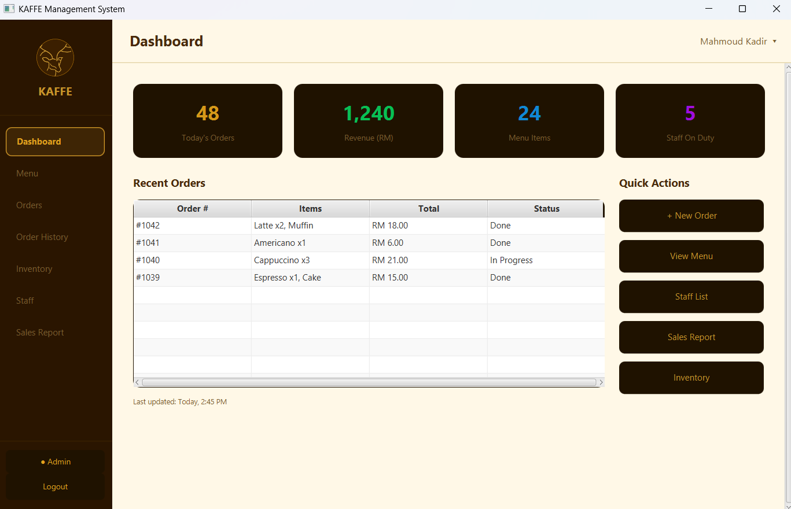
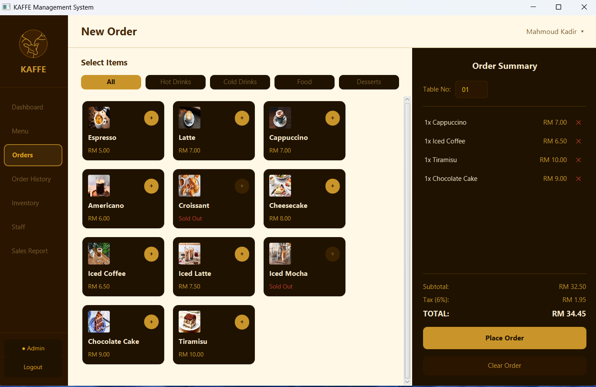
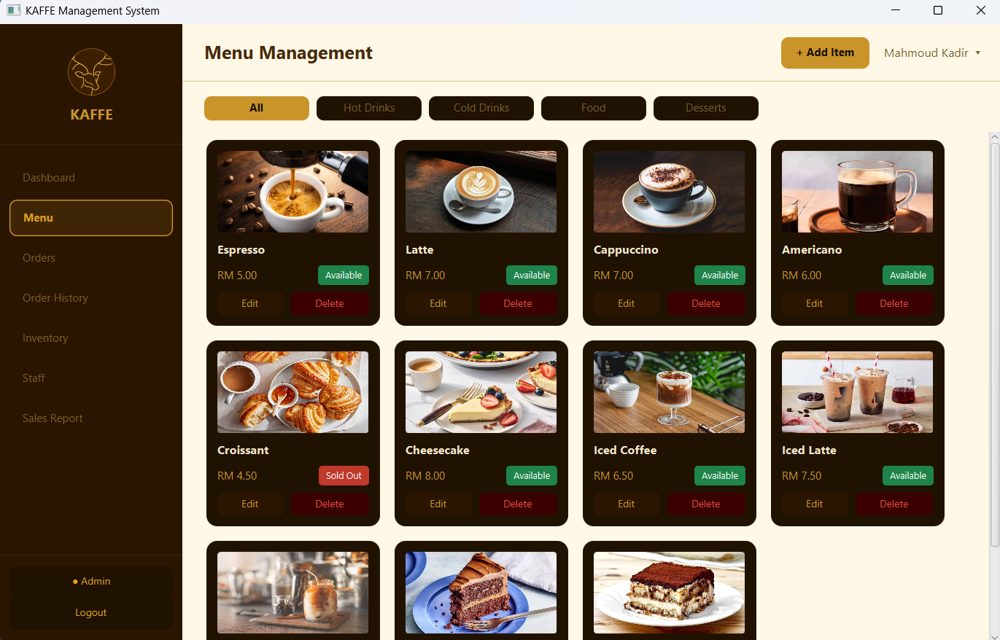
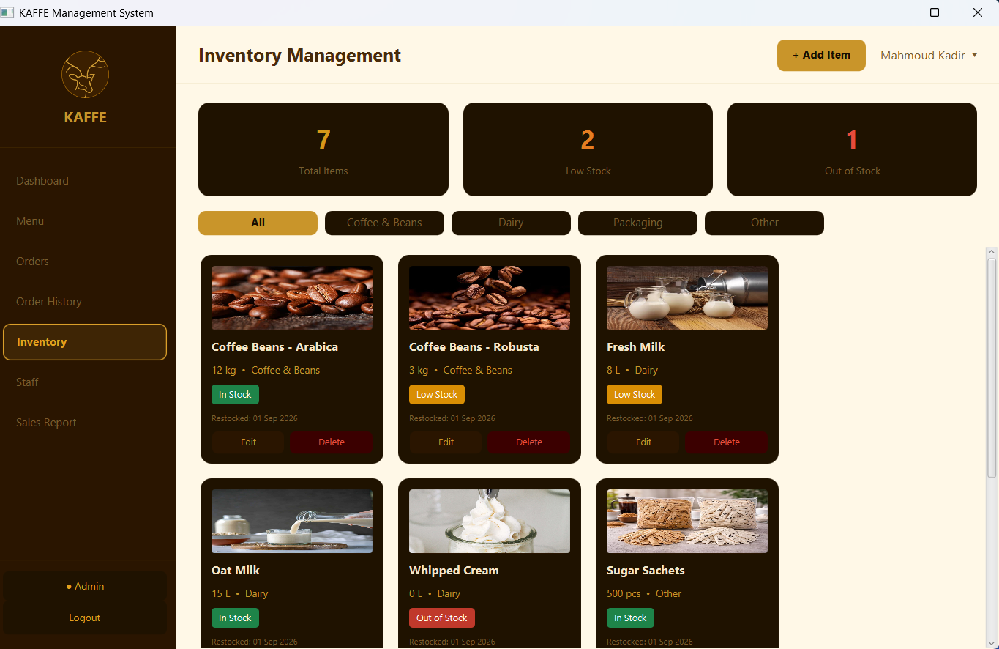

# KAFFE — Cafe Management System

A desktop point-of-sale and back-office system for a cafe, built with **Java, JavaFX, Maven, and MySQL**. Handles the full daily workflow — taking orders, managing the menu, tracking inventory, and running the front-of-house team — in one app.


## Features

- **New Order** — pick items by category, build a cart, auto-calculate subtotal/tax/total, place the order
- **Menu Management** — add, edit, and delete menu items, each with its own picture
- **Inventory Management** — track raw ingredients (coffee beans, milk, packaging, etc.), reorder-level alerts, low-stock/out-of-stock status, each item can have its own picture
- **Order History** — searchable/filterable log of every order placed, with a daily revenue summary
- **Staff Management** — add/edit/remove staff accounts with roles (Admin, Cashier, Barista), shifts, and duty status; also doubles as the login system
- **Sales Report** — revenue and item-performance breakdowns
- **Dashboard** — at-a-glance overview of the day
- **Role-based login** — Admin-only pages (like Staff Management) are hidden from non-admin accounts
- **Persistent picture uploads** — pictures for menu and inventory items are picked via a native file chooser and saved permanently, independent of where the original file was

## Tech Stack

| Layer | Technology |
|---|---|
| UI | JavaFX |
| Language | Java 21 |
| Build | Maven |
| Database | MySQL (tested with XAMPP/MariaDB) |
| DB Driver | MySQL Connector/J |

## Screenshots

| Dashboard | New Order |
|---|---|
|  |  |

| Menu Management | Inventory |
|---|---|
|  |  |

## Getting Started

### Prerequisites

- [JDK 21](https://adoptium.net/) (or compatible)
- [Maven](https://maven.apache.org/download.cgi)
- MySQL — either a standalone install or [XAMPP](https://www.apachefriends.org/) (recommended for local testing)

### 1. Clone the repository


```bash
git clone https://github.com/ALdubaiMahmood/Portfolio.git
cd Portfolio/Cafe_Managment_System_complete
```

### 2. Set up the database

Start MySQL (via XAMPP or your own install), then run the schema script:

```bash
mysql -u root -p < database/schema.sql
```

Or paste the contents of `database/schema.sql` into phpMyAdmin's SQL tab and run it.

### 3. Configure your database connection

Create `src/main/resources/db.properties`:

```properties
db.url=jdbc:mysql://localhost:3306/cafe_management_system
db.user=root
db.password=
```

> This file is intentionally excluded from version control (see `.gitignore`) since it can contain a real password — everyone who runs this project creates their own local copy.

### 4. Run the app

```bash
mvn clean javafx:run
```

### Default login

| Username | Password | Role |
|---|---|---|
| `admin_mahmoud` | `admin123` | Admin |

*(Seeded automatically the first time the app connects to an empty database — see [`StaffMember.java`](src/main/java/com/coffee/model/StaffMember.java) for the full list of seeded accounts.)*

## Project Structure

```
src/main/java/com/coffee/
├── model/       # Data + database access (MenuItem, InventoryItem, OrderRecord, StaffMember)
├── view/        # JavaFX screens (MenuView, OrderView, InventoryView, StaffView, ...)
├── util/        # DatabaseConnection, ImageStore, SessionManager
├── Main.java
└── MainLayout.java
database/
└── schema.sql   # Full database schema — run this once to set up MySQL
```

## Notes

- Uploaded pictures are stored locally in `~/.cafe_management_system/item_pictures/`, and the app saves only the file path in the database — not the image data itself.
- If the database can't be reached on startup, the app still runs using a small set of built-in sample data, so it's never completely unusable — but nothing will be saved until the connection is fixed.

## License


This project is currently unlicensed / all rights reserved by the author.
